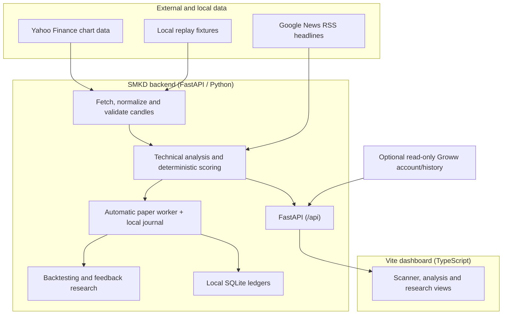

<div align="center">
  

  <h1>Stock Market Ka Don</h1>
  <p><strong>SMKD · Market analysis and paper-trading research for Indian equities</strong></p>
  <p>A local dashboard for stock scans, technical indicators, historical simulations, and paper-trading workflows.</p>

  <p>
    <a href="LICENSE"></a>
    <a href="https://www.python.org/"></a>
    <a href="https://fastapi.tiangolo.com/"></a>
    <a href="https://www.typescriptlang.org/"></a>
    <a href="https://github.com/dr-week/STOCK-MARKET-KA-DON/graphs/contributors"></a>
  </p>

  <p><a href="#features">Features</a> · <a href="#quick-start">Quick start</a> · <a href="#windows-desktop-app">Windows app</a> · <a href="#api-reference">API</a> · <a href="#limitations">Limitations</a></p>
</div>

---

> **Project status:** SMKD is an experimental NSE analysis and research dashboard, not a proven prediction system. Signals use hand-written rules, and Yahoo Finance data is not guaranteed real-time or exchange-verified. The active scanner shows loading, error, empty, and partial-result states instead of substituting sample rows when its API request fails. See the [product and technical roadmap](docs/PRODUCT_TECHNICAL_ROADMAP.md) for verified behavior and remaining gaps.

## About

**Stock Market Ka Don (SMKD)** is developed by [Danger Labs](https://github.com/dr-week) for local analysis and research on NSE equities.

---

## Maintainers and contributions

Maintained by [Danger Labs](https://github.com/dr-week). Report bugs and propose features in [GitHub Issues](https://github.com/dr-week/STOCK-MARKET-KA-DON/issues); submit focused changes as [pull requests](https://github.com/dr-week/STOCK-MARKET-KA-DON/pulls). See [CONTRIBUTING.md](CONTRIBUTING.md), [developer docs](DOCS.md), and the [documentation index](docs/INDEX.md).

Never commit API keys, broker credentials, tokens, or personal data. Market-data changes must not introduce simulated data into live application paths.

---

## Overview

**SMKD** is an experimental stock-analysis dashboard. It combines a configured NSE stock scanner, technical indicators, estimated risk levels, market headlines, historical backtesting and paper-trading tools in a local web application.

The scanner uses deterministic rules and third-party market data. It is not a validated prediction system, does not provide investment advice, and does not place broker orders. Read [what the data and signals mean](stock-signal-bot/README.md#what-is-and-is-not-trustworthy) before relying on any displayed result.

---

## Features

| Capability | What is implemented | Important limitation |
|:---|:---|:---|
| **Intraday stock scanner** | Deterministic analysis of configured NSE symbols using Yahoo Finance candle data, technical rules, and risk checks. | Yahoo is unofficial and may be delayed or unavailable; provider/fetch timestamps do not establish an exchange freshness guarantee. See the [signal-model notes](stock-signal-bot/README.md#the-active-intraday-scoring-model). |
| **Indicators and chart** | RSI, EMA, VWAP, ATR, ADX/DI, relative volume, and a built-in SVG candlestick chart with indicator overlays, proposed levels, and local annotations. | Indicators share underlying OHLCV data; chart levels are proposals, not predictions or fills. |
| **History and backtesting** | Local candle archive, feed-health checks, replay fixtures, and a short-window backtest using production signal/risk logic. | Provider history, point-in-time context, and modeled costs are limited; backtest results are research only. |
| **Automatic paper trading** | A backend worker scans during NSE weekday hours and may record risk-gated virtual positions to a local SQLite ledger. The journal also supports manual paper entry and exit. | It runs only while the backend is running, uses simulated fills, and does not submit broker orders. P&L is gross and excludes fees/slippage. |
| **Research feedback** | Closed paper outcomes can feed a local CPU training experiment and candidate report after minimum sample thresholds are met. | Research candidates are not loaded into production signals, do not edit code, and are not proof of a trading edge. |
| **News and Groww** | Keyword-tagged Google News headlines; optional loopback-only, read-only Groww account/history view and external Groww links. | News sentiment is not part of the active score. Groww access requires the user's API account/approval; this app does not place Groww orders. |
| **Web dashboard** | Vite frontend in `fast-framework/packages/stock-bot-ui`, built on the Zuari packages. | The active scanner renders loading, error, empty, and partial states; inspect source/provenance labels before relying on data. |

---

## Architecture

The current data and presentation flow is:



### Repository layout

```text
├── fast-framework/             # Danger Labs Submodule: Zuari Reactive Framework
│   └── packages/stock-bot-ui/  # High-speed reactive frontend client
├── desktop/tauri/               # Native Windows desktop app and installer source
│   ├── scripts/                 # Backend staging and first-run setup
│   └── src-tauri/               # Small Rust + system WebView2 desktop shell
└── stock-signal-bot/           # Quantitative signal engine core
    ├── backend/app/            # FastAPI analysis and research server
    │   ├── api/                # Scan, paper, feedback, history and system routes
    │   ├── departments/        # Market data, technical analysis and risk services
    │   ├── indicators/         # Indicator, profitability and sizing calculations
    │   ├── backtesting/        # Historical simulation and performance metrics
    │   └── tests/              # Unit, contract and integration tests
    └── docs/                   # API specification and product documentation
```

---

## Signal model

The active scan uses a deterministic score with seven rule groups and 10 possible points: market structure (2), supply/demand or key-candle confirmation (2), price vs VWAP (2), EMA 9/21 alignment (1), relative volume (1), momentum (1), and Nifty 50 direction (1). BUY/SELL candidates require at least 7 points plus a risk/reward check. See the [full model description and limitations](stock-signal-bot/README.md#the-active-intraday-scoring-model).

Daily data and chart-only indicators may be displayed but do not necessarily contribute to the active intraday score. News sentiment is not included in the score. The hand-authored rules have not been calibrated to predict success and do not establish positive expectancy. Groww account access is read-only; the app does not place broker orders.

---

## Quick start

### Publish code changes

On Windows, the `repo:*` commands preview eligible changes by default. Use `repo:publish` as the flexible entry point; choose a scope, local commit, or push with options:

```powershell
pnpm repo:publish -- -Help
pnpm repo:docs                                        # preview docs preset
pnpm repo:publish -- -ChangeSet Changed               # tracked + untracked changes
pnpm repo:commit -- -Include docs -Message "docs: update guide"
pnpm repo:push -- -Branch main -Remote origin -Include README.md,docs -Message "docs: refresh guides"
pnpm repo:publish -- -Action Push -Preset docs -Message "docs: publish guide updates"
```

The helper defaults to preview, uses the current branch and `origin`, and supports presets, tracked/untracked/changed selections, include/exclude filters, and optional JSON config. Copy [the example config](scripts/publish.config.example.json) to `scripts/publish.config.json` for local defaults; local config is ignored by Git. Databases, logs, credentials, generated build folders, and the `fast-framework` submodule stay blocked even when paths are requested. Read the [publishing workflow guide](docs/PUBLISH_WORKFLOW.md) for examples and configuration.

### Windows desktop app
The Tauri desktop window runs the dashboard and starts its local backend quietly. The app does not require Python, Node.js, pnpm, or a project checkout on the target PC. On first launch it checks WebView2 and installs it silently if missing, then downloads a pinned `uv` tool, private Python runtime, and locked backend packages into the current user's local app data. Internet access is needed for first setup; later launches reuse the environment. The tested portable folder is about 9 MB, while the runtime and dependencies use about 360 MB after the temporary download cache is removed. Setup and backend logs are under `%LOCALAPPDATA%\com.dangerlabs.smkd\logs`.

The installer uses the Windows WebView2 runtime instead of bundling Chromium. The NSIS installer can download the small WebView2 bootstrapper if the runtime is missing. See [Tauri's Windows installer options](https://v2.tauri.app/distribute/windows-installer/) for runtime behavior.

When the backend is running, a quiet worker scans about once a minute on weekdays during NSE session hours. Automatic paper trading is enabled in the backend: qualifying, risk-gated signals can open virtual positions in a local SQLite ledger. This stops when the backend stops and never places broker orders. Closing paper trades can feed a CPU-based research candidate after documented outcome thresholds; the candidate does not change live signals or modify application code. Optional Groww account/history endpoints are read-only and loopback-only. See [paper-trade behavior](docs/PAPER_TRADE_WORKFLOW.md), [AI training boundaries](docs/AI_TRAINING_PIPELINE.md), and [Groww integration](docs/GROWW_READ_ONLY_INTEGRATION.md).

For developers building the app, install Node.js 18+ and Rust with the MSVC C++ build tools, then run:

```powershell
cd desktop/tauri
npm install
npm run dev       # local development
npm run portable  # build an unpacked, directly runnable Windows folder
npm run build     # Windows NSIS installer
```

The downloadable launcher executable is [`launcher/Stock Market Ka Don.exe`](<launcher/Stock Market Ka Don.exe>), with a Windows shortcut beside it at [`launcher/SMKD Launcher.lnk`](<launcher/SMKD Launcher.lnk>). The shortcut opens the executable from the launcher folder. This is a portable launcher in the project folder, not an app installed in Windows Programs.

To build a fresh portable folder, run `npm run portable` from `desktop/tauri`, then launch `desktop/tauri/portable/Stock Market Ka Don.exe`. The NSIS installer, when built, is written under `desktop/tauri/src-tauri/target/release/bundle/nsis/`. First-run Python and backend setup requires internet and several hundred MB of free disk space. The launcher source and build scripts are in [`desktop/tauri`](desktop/tauri/).

### Native Android + Frontend Workflow
Use the bundled scripts for a mobile-ready local setup:

```bash
npm run dev:backend
npm run dev:ui
npm run android:sync
npm run android:open
```

The Android wrapper is already configured through Capacitor. See [docs/ANDROID_SETUP.md](docs/ANDROID_SETUP.md) for the full mobile packaging guide.

### Manual Step-by-Step Setup

#### Step 1: Clone with Submodules
```bash
git clone --recurse-submodules https://github.com/dr-week/STOCK-MARKET-KA-DON.git
cd STOCK-MARKET-KA-DON
```

#### Step 2: Start Quantitative Backend
In PowerShell, create an isolated Python environment and start the API:

```powershell
cd stock-signal-bot/backend
python -m venv .venv
.\.venv\Scripts\Activate.ps1
python -m pip install -r requirements.txt
python -m uvicorn app.main:app --reload --port 8000
```
The API is available at `http://127.0.0.1:8000`; interactive Swagger docs are at `http://127.0.0.1:8000/docs`.

#### Step 3: Start Reactive Client
In a separate terminal:
```bash
cd fast-framework/packages/stock-bot-ui
pnpm install
pnpm run dev
```
> Launch browser at `http://localhost:5173`.

---

## API reference

| Endpoint | Method | Description |
|:---|:---|:---|
| `/api/overview`, `/api/scan` | `GET` | Market overview and configured-universe scan. |
| `/api/stock/{symbol}` | `GET` | Analysis for one symbol. |
| `/api/backtest/{symbol}` | `GET` | Historical simulation; research only. |
| `/api/paper/positions`, `/api/paper/history`, `/api/paper/pnl`, `/api/paper/automation` | `GET` | Paper ledger, gross summary, and automation status. |
| `/api/paper/order`, `/api/paper/close/{id}` | `POST` | Record or close a virtual paper position; no broker order is sent. |
| `/api/paper/automation` | `PUT` | Configure paper automation; disabling is rejected by the backend. |
| `/api/groww/status`, `/api/groww/account`, `/api/groww/history/{symbol}` | `GET` | Optional loopback-only read access to connected Groww account/history data. |
| `/api/groww/connect`, `/api/groww/disconnect` | `POST` | Connect or disconnect the local read-only Groww session. |
| `/api/market-history/{symbol}` | `GET` | Local candle archive and supported history retrieval. |
| `/api/feedback/learning`, `/api/system/feed-health/{symbol}` | `GET` | Research-candidate readiness and feed-health diagnostics. |
| `/docs`, `/health` | `GET` | FastAPI interactive docs and local backend health. |

For the full route list, use `/docs` while the backend is running; routes can change as the project evolves.

---

## Limitations

Active issues, architectural constraints, and enhancement roadmaps are tracked transparently in the **[GitHub Issues tab](https://github.com/dr-week/STOCK-MARKET-KA-DON/issues)**:

1. **Unofficial market data:** Yahoo Finance is not an exchange-certified real-time feed. Fresh fetch time does not prove quote freshness; stale/delayed classification and provider availability remain limitations.
2. **Fallback context and fundamentals:** some market-context and company metrics use fixed/static defaults; review data-source labels and the roadmap before interpreting them as live observations.
3. **Research limits:** short-window backtests use simplified assumptions and incomplete point-in-time context. They do not establish profitability or future performance.
4. **Paper-only trading:** automatic paper positions are simulated locally. No broker order placement, real fills, fees, or slippage are modeled by the paper ledger.

---

## Disclaimer

*Stock Market Ka Don (SMKD) is an educational and analytical research technology platform developed by Danger Labs. It does not constitute financial, investment, or legal advice. Danger Labs and its contributors are not SEBI-registered investment advisors. Equity and derivatives trading involve substantial financial risk. Past statistical performance does not guarantee future market results. Always manage risk responsibly.*

---

<div align="center">
  <sub>Copyright © 2026 <b>Danger Labs</b>. All rights reserved.</sub>
</div>
