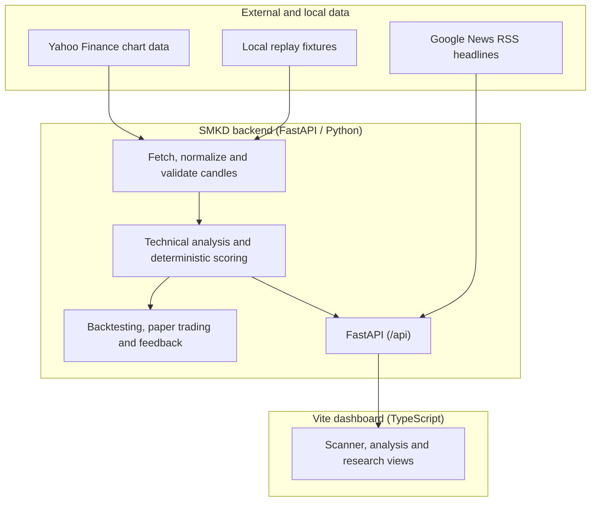

<div align="center">
  

  <h1>Stock Market Ka Don</h1>
  <p><strong>SMKD · Market analysis and paper-trading research for Indian equities</strong></p>
  <p>A local dashboard for stock scans, technical indicators, historical simulations, and paper-trading workflows.</p>

  <p>
    <a href="LICENSE"></a>
    <a href="https://www.python.org/"></a>
    <a href="https://fastapi.tiangolo.com/"></a>
    <a href="https://www.typescriptlang.org/"></a>
    <a href="https://github.com/dr-week/STOCK-MARKET-KA-DON/graphs/contributors"></a>
  </p>

  <p><a href="#features">Features</a> · <a href="#quick-start">Quick start</a> · <a href="#windows-desktop-app">Windows app</a> · <a href="#api-reference">API</a> · <a href="#limitations">Limitations</a></p>
</div>

---

> **Project status:** SMKD is an experimental NSE analysis dashboard, not a proven prediction system. Signal output uses deterministic rule scoring; market-data freshness is not guaranteed, and some UI paths can show sample rows when the API fails. See the [product and technical roadmap](docs/PRODUCT_TECHNICAL_ROADMAP.md) and [documentation index](docs/INDEX.md) for current behavior and known gaps.

## About

**Stock Market Ka Don (SMKD)** is developed by [Danger Labs](https://github.com/dr-week). The project brings together an NSE scanner, analysis tools, historical research, and local paper trading in one application.

---

## Maintainers and contributions

**Created and maintained by [Danger Labs](https://github.com/dr-week).**

SMKD is an evolving market-analysis and trading research project. Contributions, reproducible bug reports, test improvements, documentation fixes, and thoughtful feature proposals are welcome.

- **Creator / maintainer:** [@dr-week](https://github.com/dr-week)
- **Report a bug:** [Open an issue](https://github.com/dr-week/STOCK-MARKET-KA-DON/issues/new)
- **Suggest an improvement:** [Feature requests](https://github.com/dr-week/STOCK-MARKET-KA-DON/issues)
- **Contribute code:** [Open a pull request](https://github.com/dr-week/STOCK-MARKET-KA-DON/pulls)
- **Contribution guide:** [CONTRIBUTING.md](CONTRIBUTING.md)
- **Developer docs and research search:** [DOCS.md](DOCS.md) · [documentation index](docs/INDEX.md)

### Useful links

- [Issues and bug reports](https://github.com/dr-week/STOCK-MARKET-KA-DON/issues)
- [Pull requests](https://github.com/dr-week/STOCK-MARKET-KA-DON/pulls)
- [Contributor history](https://github.com/dr-week/STOCK-MARKET-KA-DON/graphs/contributors)
- [Developer docs](DOCS.md) · [documentation index](docs/INDEX.md)

For contributions, keep pull requests focused, include tests or reproducible steps for bug fixes, and never commit API keys, broker credentials, tokens, or personal data. Market-data changes must not introduce simulated data into live application paths. See [CONTRIBUTING.md](CONTRIBUTING.md).

---

## Overview

**SMKD** is an experimental stock-analysis dashboard. It combines a configured NSE stock scanner, technical indicators, estimated risk levels, market headlines, historical backtesting and paper-trading tools in a local web application.

The scanner uses deterministic rules and third-party market data. It is not a validated prediction system, does not provide investment advice, and does not place broker orders. Read [what the data and signals mean](stock-signal-bot/README.md#what-is-and-is-not-trustworthy) before relying on any displayed result.

---

## Features

| Capability | What is implemented | Important limitation |
|:---|:---|:---|
| **Intraday stock scanner** | Deterministic scoring of configured NSE stocks from 5-minute OHLCV data using market structure, VWAP, EMA alignment, relative volume and momentum. | Experimental heuristic; provider timestamps and in-progress candles are not reliably validated. See [backend README](stock-signal-bot/README.md#the-active-intraday-scoring-model). |
| **Technical analysis and risk levels** | RSI, EMA, VWAP, ATR, ADX/DI, volume, price-structure and zone calculations with candidate entry, stop and target levels. | Calculations are correlated inputs from the same feed; levels are not predictions or guarantees. |
| **Market-data and research tools** | Candle normalization, local replay fixtures, history storage, feed-health diagnostics and a backtest that reuses production signal/risk logic. | Yahoo Finance availability/delay varies; backtest coverage and cost estimates are limited. |
| **Paper trading and feedback** | Local paper-order ledger, position/P&L views, optional automation and feedback recording/summary endpoints. | Paper trades do not place real broker orders and do not establish live profitability. |
| **News and broker links** | Keyword-tagged Google News RSS headlines and links that open external Groww stock pages. | News is not part of the active score; the app does not execute Groww orders or use a live Groww/NSE feed. |
| **Web dashboard** | Vite frontend in `fast-framework/packages/stock-bot-ui`, built on the Zuari packages. | Some UI paths may show sample rows after API failure; do not treat them as live data. |

---

## Architecture

The current data and presentation flow is:



### Repository layout

```text
├── fast-framework/             # Danger Labs Submodule: Zuari Reactive Framework
│   └── packages/stock-bot-ui/  # High-speed reactive frontend client
├── desktop/tauri/               # Native Windows desktop app and installer source
│   ├── scripts/                 # Backend staging and first-run setup
│   └── src-tauri/               # Small Rust + system WebView2 desktop shell
└── stock-signal-bot/           # Quantitative signal engine core
    ├── backend/app/            # FastAPI analysis and research server
    │   ├── api/                # Scan, paper, feedback, history and system routes
    │   ├── departments/        # Market data, technical analysis and risk services
    │   ├── indicators/         # Indicator, profitability and sizing calculations
    │   ├── backtesting/        # Historical simulation and performance metrics
    │   └── tests/              # Unit, contract and integration tests
    └── docs/                   # API specification and product documentation
```

---

## Signal model

The active scan uses a deterministic score with seven rule groups and 10 possible points: market structure (2), supply/demand or key-candle confirmation (2), price vs VWAP (2), EMA 9/21 alignment (1), relative volume (1), momentum (1), and Nifty 50 direction (1). BUY/SELL candidates require at least 7 points plus a risk/reward check. See the [full model description and limitations](stock-signal-bot/README.md#the-active-intraday-scoring-model).

Daily data and other dashboard indicators may be displayed but do not necessarily contribute to the active intraday score. News sentiment is not included in the score. This model has not been calibrated to predict success and does not guarantee positive expectancy. Groww integration provides external links; it does not place orders.

---

## Quick start

### Publish code changes

On Windows, the `repo:*` commands preview eligible changes by default. Use `repo:publish` as the flexible entry point; choose a scope, local commit, or push with options:

```powershell
pnpm repo:publish -- -Help
pnpm repo:docs                                        # preview docs preset
pnpm repo:publish -- -ChangeSet Changed               # tracked + untracked changes
pnpm repo:commit -- -Include docs -Message "docs: update guide"
pnpm repo:push -- -Branch main -Remote origin -Include README.md,docs -Message "docs: refresh guides"
pnpm repo:publish -- -Action Push -Preset docs -Message "docs: publish guide updates"
pnpm repo:publish -- -Action Push -Preset docs -Message "docs: publish guide updates"
```

The helper defaults to preview, uses the current branch and `origin`, and supports presets, tracked/untracked/changed selections, include/exclude filters, and optional JSON config. Copy [the example config](scripts/publish.config.example.json) to `scripts/publish.config.json` for local defaults; local config is ignored by Git. Databases, logs, credentials, generated build folders, and the `fast-framework` submodule stay blocked even when paths are requested. Read the [publishing workflow guide](docs/PUBLISH_WORKFLOW.md) for examples and configuration.

### Windows desktop app
The Tauri desktop window runs the dashboard and starts its local backend quietly. The app does not require Python, Node.js, pnpm, or a project checkout on the target PC. On first launch it checks WebView2 and installs it silently if missing, then downloads a pinned `uv` tool, private Python runtime, and locked backend packages into the current user's local app data. Internet access is needed for first setup; later launches reuse the environment. The tested portable folder is about 9 MB, while the runtime and dependencies use about 360 MB after the temporary download cache is removed. Setup and backend logs are under `%LOCALAPPDATA%\com.dangerlabs.smkd\logs`.

The installer uses the Windows WebView2 runtime instead of bundling Chromium. The NSIS installer can download the small WebView2 bootstrapper if the runtime is missing. See [Tauri's Windows installer options](https://v2.tauri.app/distribute/windows-installer/) for runtime behavior.

While the backend is open, its quiet worker scans on weekdays during NSE hours and records qualifying trades to a local SQLite paper ledger; it never places broker orders. A separate background trainer can save research candidates after enough labeled outcomes, but it does not change live signals. There is no Hermes coding agent installed in SMKD. See [paper-trade behavior and safeguards](docs/PAPER_TRADE_WORKFLOW.md) and [AI training boundaries](docs/AI_TRAINING_PIPELINE.md).

For developers building the app, install Node.js 18+ and Rust with the MSVC C++ build tools, then run:

```powershell
cd desktop/tauri
npm install
npm run dev       # local development
npm run portable  # build an unpacked, directly runnable Windows folder
npm run build     # Windows NSIS installer
```

The portable app folder is `desktop/tauri/portable/`; run `Stock Market Ka Don.exe` from that folder. It is not installed in Windows Programs. The NSIS installer, when built, is written under `desktop/tauri/src-tauri/target/release/bundle/nsis/`. Both run without developer tools on the target PC. First-run Python and backend setup requires internet and several hundred MB of free disk space.

### Native Android + Frontend Workflow
Use the bundled scripts for a mobile-ready local setup:

```bash
npm run dev:backend
npm run dev:ui
npm run android:sync
npm run android:open
```

The Android wrapper is already configured through Capacitor. See [docs/ANDROID_SETUP.md](docs/ANDROID_SETUP.md) for the full mobile packaging guide.

### Manual Step-by-Step Setup

#### Step 1: Clone with Submodules
```bash
git clone --recurse-submodules https://github.com/dr-week/STOCK-MARKET-KA-DON.git
cd STOCK-MARKET-KA-DON
```

#### Step 2: Start Quantitative Backend
```bash
cd stock-signal-bot/backend
python -m pip install -r requirements.txt
python -m uvicorn app.main:app --reload --port 8000
```
> The API will be available at `http://127.0.0.1:8000` with interactive Swagger docs at `http://127.0.0.1:8000/docs`.

#### Step 3: Start Reactive Client
In a separate terminal:
```bash
cd fast-framework/packages/stock-bot-ui
pnpm install
pnpm run dev
```
> Launch browser at `http://localhost:5173`.

---

## API reference

| Endpoint | Method | Description |
|:---|:---|:---|
| `/api/overview` | `GET` | Dashboard overview and market summary. |
| `/api/scan` | `GET` | Scan the configured stock universe. |
| `/api/stock/{symbol}` | `GET` | Analysis for one symbol. |
| `/api/backtest/{symbol}` | `GET` | Historical strategy simulation (research only). |
| `/api/paper/positions`, `/api/paper/history`, `/api/paper/pnl` | `GET` | Paper-trading positions, history and P&L. |
| `/docs` | `GET` | FastAPI interactive API documentation. |

For the full route list, use `/docs` while the backend is running; routes can change as the project evolves.

---

## Limitations

Active issues, architectural constraints, and enhancement roadmaps are tracked transparently in the **[GitHub Issues tab](https://github.com/dr-week/STOCK-MARKET-KA-DON/issues)**:

1. **Third-Party Rate Limits**: Upstream Yahoo Finance / unofficial tick providers may enforce intermittent rate limits during high market volatility. Integration of official broker WebSocket APIs (Zerodha Kite Connect / Groww API) is planned.
2. **Delayed Indian Feed on Free Endpoints**: Free upstream data tiers may experience a 1–2 minute delay. Production deployments should attach a paid low-latency market data feed.
3. **Automated Order Placement Requires Broker Credentials**: Currently provides verified direct deep-links to Groww order tickets; automated non-supervised trade execution requires active TOTP broker authorization.
4. **Execution Slippage**: Rapid gap openings between 9:15 AM and 9:20 AM may cause execution price variance from calculated entry prices.

---

## Disclaimer

*Stock Market Ka Don (SMKD) is an educational and analytical research technology platform developed by Danger Labs. It does not constitute financial, investment, or legal advice. Danger Labs and its contributors are not SEBI-registered investment advisors. Equity and derivatives trading involve substantial financial risk. Past statistical performance does not guarantee future market results. Always manage risk responsibly.*

---

<div align="center">
  <sub>Copyright © 2026 <b>Danger Labs</b>. All rights reserved.</sub>
</div>
