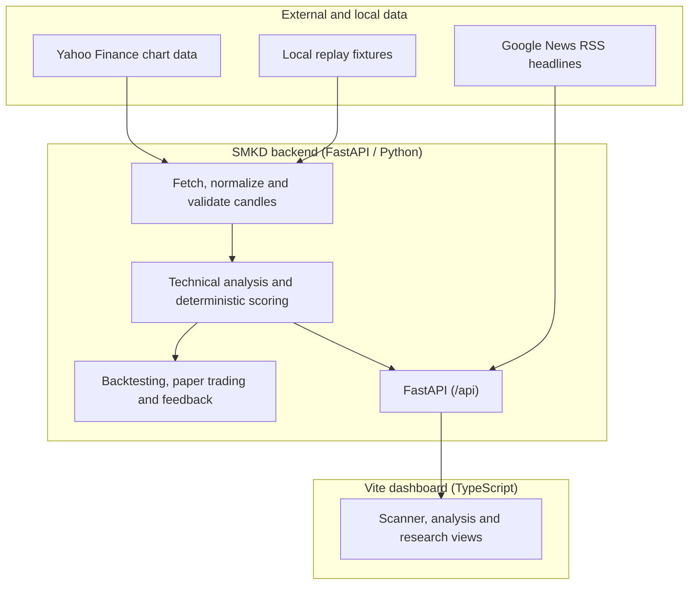

<div align="center">

# ⚡ STOCK MARKET KA DON (SMKD)
### Experimental market-analysis dashboard for Indian equities (NSE)

[](#-designed--engineered-by-danger-labs)
[](LICENSE)
[](https://python.org)
[](https://fastapi.tiangolo.com)
[](https://www.typescriptlang.org)
[](#-frontend-architecture)
[](https://www.nseindia.com)

<p align="center">
  <b>A local dashboard for exploring stock scans, technical indicators, historical simulations and paper-trading workflows.</b>
</p>

[Key Features](#-key-features) • [System Architecture](#-system-architecture) • [Trading Strategies](#-trading-engine--strategy-matrix) • [Quick Start](#-quick-start--installation) • [API Reference](#-api-specification) • [Limitations & Disclaimer](#-limitations--known-constraints)

---

</div>

> **Verified implementation status (2026-11-03):** SMKD is an experimental NSE analysis dashboard, not a proven prediction system. Signal output uses deterministic rule scoring; market-data freshness is not guaranteed, and some UI paths can show sample rows when the API fails. The feature list below describes implemented capabilities and links to their limitations. See [the verified product and technical roadmap](docs/PRODUCT_TECHNICAL_ROADMAP.md) and [documentation index](docs/INDEX.md) for current behavior and gaps.

## 🏢 Designed & Engineered by Danger Labs

**Stock Market Ka Don (SMKD)** was architected and built by **Danger Labs**, an elite engineering research and quantitative trading systems lab. Danger Labs designs mission-critical algorithmic software, high-frequency signal pipelines, and low-latency reactive frontends.

> *"Precision over hype. Mathematical expectancy over speculation."* — **Danger Labs Core Philosophy**

---

## 👨‍💻 Creator, Maintainers & Contributors

**Created and maintained by [Danger Labs](https://github.com/dr-week).**

SMKD is an evolving market-analysis and trading research project. Contributions, reproducible bug reports, test improvements, documentation fixes, and thoughtful feature proposals are welcome.

- **Creator / maintainer:** [@dr-week](https://github.com/dr-week)
- **Report a bug:** [Open an issue](https://github.com/dr-week/STOCK-MARKET-KA-DON/issues/new)
- **Suggest an improvement:** [Feature requests](https://github.com/dr-week/STOCK-MARKET-KA-DON/issues)
- **Contribute code:** [Open a pull request](https://github.com/dr-week/STOCK-MARKET-KA-DON/pulls)
- **Contribution guide:** [CONTRIBUTING.md](CONTRIBUTING.md)
- **Developer docs and research search:** [DOCS.md](DOCS.md) · [documentation index](docs/INDEX.md)

### Repository activity

[](https://github.com/dr-week/STOCK-MARKET-KA-DON/stargazers)
[](https://github.com/dr-week/STOCK-MARKET-KA-DON/forks)
[](https://github.com/dr-week/STOCK-MARKET-KA-DON/issues)
[](https://github.com/dr-week/STOCK-MARKET-KA-DON/pulls)
[](https://github.com/dr-week/STOCK-MARKET-KA-DON/commits/main)

### Meet the contributors

Contributions are credited through GitHub's contributor history.

[](https://github.com/dr-week/STOCK-MARKET-KA-DON/graphs/contributors)

[View all contributors](https://github.com/dr-week/STOCK-MARKET-KA-DON/graphs/contributors) · [View commit history](https://github.com/dr-week/STOCK-MARKET-KA-DON/commits/main) · [View releases](https://github.com/dr-week/STOCK-MARKET-KA-DON/releases)

### How to contribute

1. Open or review an issue before starting a large change.
2. Keep pull requests focused and explain the reason for the change.
3. Include tests or reproducible steps when fixing a bug.
4. Never commit API keys, broker credentials, tokens, or personal data.
5. Do not introduce simulated market data into live application paths.
6. Clearly state what you tested and what remains unverified.

All market-data, signal-generation, and trading-related changes must preserve the project's safety and data-integrity requirements. See the [Issues](https://github.com/dr-week/STOCK-MARKET-KA-DON/issues) and [Pull Requests](https://github.com/dr-week/STOCK-MARKET-KA-DON/pulls) pages before contributing.

---

## 📌 Executive Summary

**SMKD** is an experimental stock-analysis dashboard. It combines a configured NSE stock scanner, technical indicators, estimated risk levels, market headlines, historical backtesting and paper-trading tools in a local web application.

The scanner uses deterministic rules and third-party market data. It is not a validated prediction system, does not provide investment advice, and does not place broker orders. Read [what the data and signals mean](stock-signal-bot/README.md#what-is-and-is-not-trustworthy) before relying on any displayed result.

---

## 🌟 Key Features

| Capability | What is implemented | Important limitation |
|:---|:---|:---|
| **Intraday stock scanner** | Deterministic scoring of configured NSE stocks from 5-minute OHLCV data using market structure, VWAP, EMA alignment, relative volume and momentum. | Experimental heuristic; provider timestamps and in-progress candles are not reliably validated. See [backend README](stock-signal-bot/README.md#the-active-intraday-scoring-model). |
| **Technical analysis and risk levels** | RSI, EMA, VWAP, ATR, ADX/DI, volume, price-structure and zone calculations with candidate entry, stop and target levels. | Calculations are correlated inputs from the same feed; levels are not predictions or guarantees. |
| **Market-data and research tools** | Candle normalization, local replay fixtures, history storage, feed-health diagnostics and a backtest that reuses production signal/risk logic. | Yahoo Finance availability/delay varies; backtest coverage and cost estimates are limited. |
| **Paper trading and feedback** | Local paper-order ledger, position/P&L views, optional automation and feedback recording/summary endpoints. | Paper trades do not place real broker orders and do not establish live profitability. |
| **News and broker links** | Keyword-tagged Google News RSS headlines and links that open external Groww stock pages. | News is not part of the active score; the app does not execute Groww orders or use a live Groww/NSE feed. |
| **Web dashboard** | Vite frontend in `fast-framework/packages/stock-bot-ui`, built on the Zuari packages. | Some UI paths may show sample rows after API failure; do not treat them as live data. |

---

## 🏗️ System Architecture

The current data and presentation flow is:



### Directory Structure

```text
├── fast-framework/             # Danger Labs Submodule: Zuari Reactive Framework
│   └── packages/stock-bot-ui/  # High-speed reactive frontend client
├── launcher/                   # Quiet Windows launcher and local service startup
│   ├── instance_manager.py     # Port allocation, pid tracking & graceful shutdowns
│   ├── launch.py               # Hidden service startup and readiness checks
│   ├── start-hidden.vbs        # Runs the launcher without a console window
│   └── start.bat               # Starts hidden services and opens the dashboard
└── stock-signal-bot/           # Quantitative signal engine core
    ├── backend/app/            # FastAPI analysis and research server
    │   ├── api/                # Scan, paper, feedback, history and system routes
    │   ├── departments/        # Market data, technical analysis and risk services
    │   ├── indicators/         # Indicator, profitability and sizing calculations
    │   ├── backtesting/        # Historical simulation and performance metrics
    │   └── tests/              # Unit, contract and integration tests
    └── docs/                   # API specification and product documentation
```

---

## 📊 Current signal model

The active scan uses a deterministic score with seven rule groups and 10 possible points: market structure (2), supply/demand or key-candle confirmation (2), price vs VWAP (2), EMA 9/21 alignment (1), relative volume (1), momentum (1), and Nifty 50 direction (1). BUY/SELL candidates require at least 7 points plus a risk/reward check. See the [full model description and limitations](stock-signal-bot/README.md#the-active-intraday-scoring-model).

Daily data and other dashboard indicators may be displayed but do not necessarily contribute to the active intraday score. News sentiment is not included in the score. This model has not been calibrated to predict success and does not guarantee positive expectancy. Groww integration provides external links; it does not place orders.

---

## ⚡ Quick Start & Installation

### Prerequisites
- **Python**: 3.11+ (with pip)
- **Node.js**: 18+ & **pnpm**: 9+
- **Git**

### Automated Launch (Windows)
Double-click the launcher. It starts the backend and frontend without persistent terminal windows, waits for the dashboard to respond, then opens it in your browser. Startup logs are written to `.runtime/launcher/` if troubleshooting is needed.

```powershell
.\launcher\start.bat
```

### Native Android + Frontend Workflow
Use the bundled scripts for a mobile-ready local setup:

```bash
npm run dev:backend
npm run dev:ui
npm run android:sync
npm run android:open
```

The Android wrapper is already configured through Capacitor. See [docs/ANDROID_SETUP.md](docs/ANDROID_SETUP.md) for the full mobile packaging guide.

### Manual Step-by-Step Setup

#### Step 1: Clone with Submodules
```bash
git clone --recurse-submodules https://github.com/dr-week/STOCK-MARKET-KA-DON.git
cd STOCK-MARKET-KA-DON
```

#### Step 2: Start Quantitative Backend
```bash
cd stock-signal-bot/backend
python -m pip install -r requirements.txt
python -m uvicorn app.main:app --reload --port 8000
```
> The API will be available at `http://127.0.0.1:8000` with interactive Swagger docs at `http://127.0.0.1:8000/docs`.

#### Step 3: Start Reactive Client
In a separate terminal:
```bash
cd fast-framework/packages/stock-bot-ui
pnpm install
pnpm run dev
```
> Launch browser at `http://localhost:5173`.

---

## 📡 API Specification

| Endpoint | Method | Description |
|:---|:---|:---|
| `/api/overview` | `GET` | Dashboard overview and market summary. |
| `/api/scan` | `GET` | Scan the configured stock universe. |
| `/api/stock/{symbol}` | `GET` | Analysis for one symbol. |
| `/api/backtest/{symbol}` | `GET` | Historical strategy simulation (research only). |
| `/api/paper/positions`, `/api/paper/history`, `/api/paper/pnl` | `GET` | Paper-trading positions, history and P&L. |
| `/docs` | `GET` | FastAPI interactive API documentation. |

For the full route list, use `/docs` while the backend is running; routes can change as the project evolves.

---

## ⚠️ Limitations & Known Constraints

Active issues, architectural constraints, and enhancement roadmaps are tracked transparently in the **[GitHub Issues tab](https://github.com/dr-week/STOCK-MARKET-KA-DON/issues)**:

1. **Third-Party Rate Limits**: Upstream Yahoo Finance / unofficial tick providers may enforce intermittent rate limits during high market volatility. Integration of official broker WebSocket APIs (Zerodha Kite Connect / Groww API) is planned.
2. **Delayed Indian Feed on Free Endpoints**: Free upstream data tiers may experience a 1–2 minute delay. Production deployments should attach a paid low-latency market data feed.
3. **Automated Order Placement Requires Broker Credentials**: Currently provides verified direct deep-links to Groww order tickets; automated non-supervised trade execution requires active TOTP broker authorization.
4. **Execution Slippage**: Rapid gap openings between 9:15 AM and 9:20 AM may cause execution price variance from calculated entry prices.

---

## ⚖️ Legal Disclaimer

*Stock Market Ka Don (SMKD) is an educational and analytical research technology platform developed by Danger Labs. It does not constitute financial, investment, or legal advice. Danger Labs and its contributors are not SEBI-registered investment advisors. Equity and derivatives trading involve substantial financial risk. Past statistical performance does not guarantee future market results. Always manage risk responsibly.*

---

<div align="center">
  <sub>Copyright © 2026 <b>Danger Labs</b>. All rights reserved.</sub>
</div>
